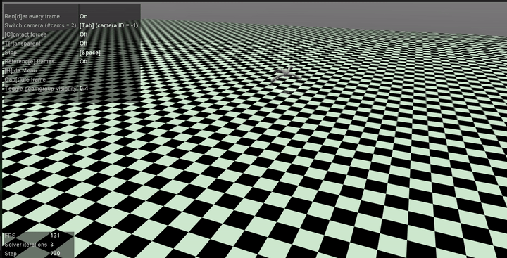
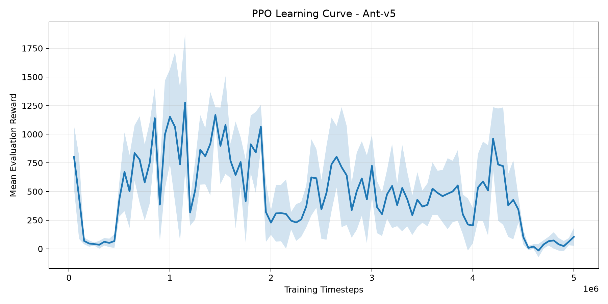
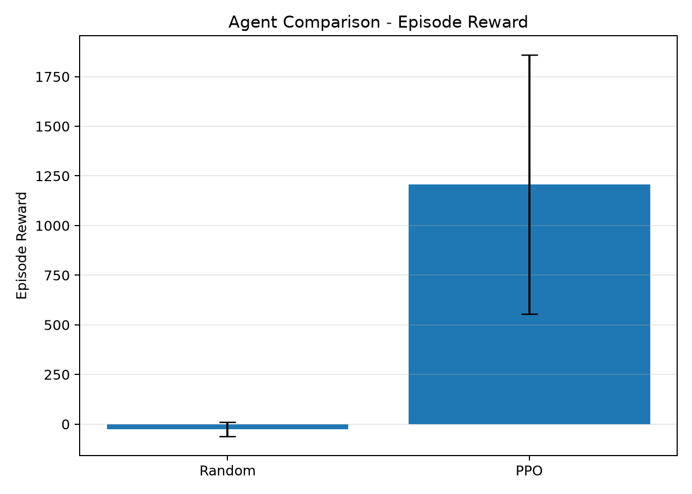
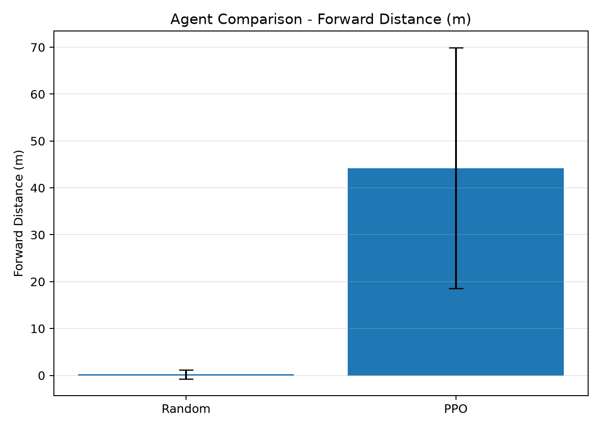

# 🐾 Quadruped Robot Learning with PPO

Training a four-legged robot to walk using Deep Reinforcement Learning.

## 🎬 Demo — Trained PPO Agent




## 📊 Training & Evaluation Results

### PPO Learning Curve

The following plot shows the mean evaluation reward
over training timesteps. The shaded region represents
the standard deviation across evaluation episodes.



### Random Agent vs Trained PPO

Both agents are evaluated over 20 episodes using
the same environment reset seeds.

#### Episode Reward



#### Forward Distance



### Quantitative Evaluation

See the [Evaluation Summary](results/evaluation_summary.md)
for measured rewards, forward displacement,
and episode lengths.

The trained PPO agent was evaluated against a random
policy over 20 episodes using identical reset seeds.

| Metric | Random Agent | Trained PPO |
|---|---:|---:|
| Mean Episode Reward | -25.79 ± 35.82 | **1206.82 ± 652.20** |
| Mean Forward Distance | 0.21 ± 0.97 m | **44.23 ± 25.66 m** |
| Mean Episode Length | 90.65 ± 77.25 | **715.15 ± 369.80** |

Values represent mean ± sample standard deviation.

**Key Finding:** PPO substantially outperformed the
random baseline in this evaluation, demonstrating
successful reward-driven locomotion learning.

The trained agent achieved positive forward displacement
in all 20 evaluation episodes.

Individual episode results are available in
[evaluation.csv](results/evaluation.csv).


## Overview

This project trains a quadruped robot from scratch using
Proximal Policy Optimization (PPO).

The agent interacts with the MuJoCo Ant-v5 environment,
receives rewards, and learns a locomotion policy through
trial and error.

## Tech Stack

- Python
- PyTorch
- Gymnasium
- MuJoCo
- Stable-Baselines3
- TensorBoard

## Installation

Create a Python virtual environment:

```bash
python3 -m venv .venv
source .venv/bin/activate
```

Install CPU-only PyTorch:

```bash
pip install torch --index-url https://download.pytorch.org/whl/cpu
```

Install the remaining dependencies:

```bash
pip install -r requirements.txt
```

## Usage

### 1. Random Agent

Observe the robot before training:

```bash
python quadruped_rl.py random
```

### 2. Train the Agent

Train a PPO policy from scratch:

```bash
python quadruped_rl.py train --steps 3000000 --envs 4
```

### 3. Watch the Trained Agent

```bash
python quadruped_rl.py watch
```

### 4. Monitor Training

```bash
tensorboard --logdir runs
```

Open http://localhost:6006

### 5. Resume Training

```bash
python quadruped_rl.py train --steps 1000000 --envs 4 --resume models/last_model.zip
```

## Reinforcement Learning Setup

- Environment: Ant-v5
- Algorithm: PPO
- Policy: MLP
- Action Space: Continuous (8 actuators)
- Observation Space: 105-dimensional vector
- Training Device: CPU

## Outputs

Training generates:

- Best-performing evaluation checkpoint
- Latest trained model
- Periodic training checkpoints
- TensorBoard training logs

Generated models and logs are excluded from Git.

## Project Goal

Explore deep reinforcement learning through robotic
locomotion, policy optimization, reward-driven learning,
and simulation-based training.
